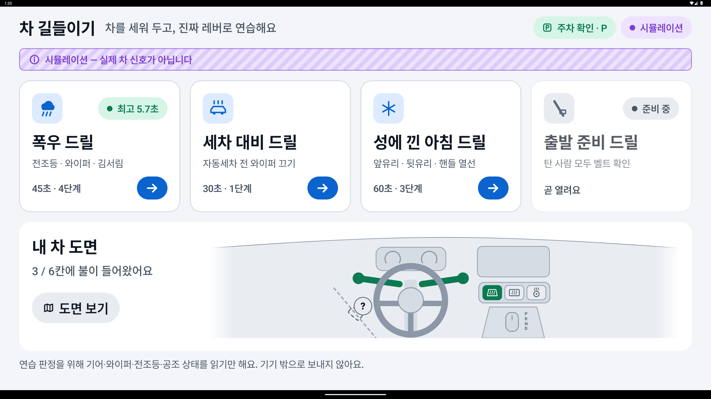
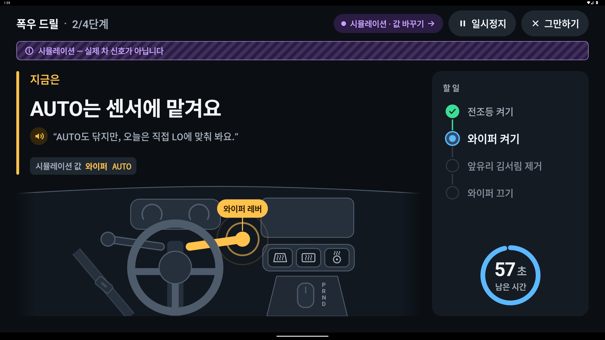
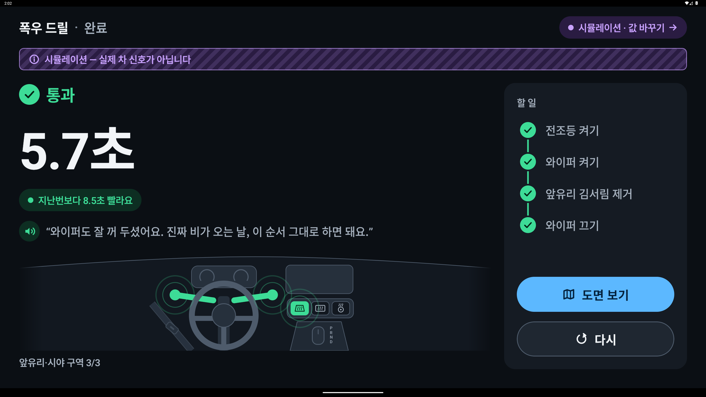

# 차 길들이기

**차를 세워 두고 진짜 레버와 버튼을 움직이면, 차가 읽은 값(Pleos Vehicle SDK)으로 정답을 판정하는 차 기능 실습 앱입니다.**

> 이 앱은 공모전 출품용 프로토타입입니다. 42dot·현대자동차그룹이 만들거나 보증한 앱이 아닙니다.

## 스크린샷

| 홈 | 폭우 드릴 진행 |
|---|---|
|  |  |
| **오조작 안내** | **완료** |
|  |  |

나머지 화면(밤 테마, 주행 중 정지, 시간 초과, 내 차 도면, 시뮬레이터 패널 등)은 [docs/screenshots/](docs/screenshots/)에 있습니다.

## 주요 기능

- **실습 드릴**: 화면이 "전조등을 켜세요"처럼 한 가지씩 지시하면, 운전자가 실제 레버·버튼을 움직입니다. 앱은 Vehicle SDK로 그 값을 읽어 1초 동안 유지되면 통과로 판정합니다.
- **드릴 4종**: 폭우 드릴(전조등 → 와이퍼 → 앞유리 김서림 → 와이퍼 끄기), 세차 대비 드릴, 성에 낀 아침 드릴, 출발 준비 드릴("준비 중"). 드릴은 `app/src/main/assets/quests/*.json` 데이터이고 엔진 하나가 모두 판정합니다.
- **오조작 안내**: 다른 값으로 바꾸면 바로 "지금은 …예요"로 고쳐 알려 줍니다. 시간이 다 되면 "괜찮아요. 여기 있어요"와 함께 못 찾은 조작부 위치를 크게 보여 줍니다.
- **위치 그림과 내 차 도면**: 운전석에서 본 그림에 지금 찾을 조작부가 깜빡이고, 해 본 조작부는 도면에 불이 켜집니다.
- **안전 단계**: 주차(P)에서만 드릴이 열립니다. 주행 중에는 "주행 중에는 쉬어요" 화면으로 바뀌고, 다시 P에 두면 "이어서 할까요?"가 나옵니다.
- **판정 로그**: 차가 읽은 값과 판정 이유를 시간순으로 보여 줍니다. 예: `00:21.8 · Wiper 스위치 OFF → CONTINUOUS_LEVEL_1 · 1초 안정 · 통과`
- **시뮬레이션 모드**: Vehicle Service가 없는 기기에서도 화면에 표시된 시뮬레이션 값으로 전체 흐름을 볼 수 있습니다.
- **음성 안내**(기기 TTS), **낮/밤 테마**, 큰 글씨와 76dp 이상 터치 영역.

## 실행 방법

### 1) APK 설치

```sh
adb install -r "apk/TEAM_차길들이기_release.apk"
```

여러 기기가 연결되어 있으면 `adb -s <기기 serial> install -r …`로 대상을 지정합니다. 런처에서 **차 길들이기**를 엽니다.

### 2) 소스에서 빌드

```sh
export JAVA_HOME="/Applications/Android Studio.app/Contents/jbr/Contents/Home"   # JDK 17 이상
./gradlew assembleDebug testDebugUnitTest   # 디버그 APK + 단위 테스트
./gradlew assembleRelease                   # release APK (서명 설정 필요, 아래 참고)
```

- 결과물: `app/build/outputs/apk/debug/app-debug.apk`, `app/build/outputs/apk/release/app-release.apk`
- release 서명은 저장소 루트의 `keystore.properties`(git에 올리지 않음)에서 읽습니다. 직접 빌드할 때는 자신의 키스토어로 아래 4줄을 만들어 두세요. 파일이 없으면 서명되지 않은 release APK가 만들어집니다.
  ```properties
  storeFile=/절대/경로/my-release.jks
  keyAlias=…
  storePassword=…
  keyPassword=…
  ```

### 3) Pleos Connect 에뮬레이터 + Virtual Console에서 실행

1. Pleos Connect 에뮬레이터를 켜고 APK를 설치합니다.
2. Virtual Console의 **Gear Selection** 카드에서 기어를 **P**에 둡니다. 홈의 드릴 카드가 열립니다.
3. **폭우 드릴**을 누르고, 화면 지시에 따라 Virtual Console에서 조작합니다.
   - 전조등 켜기 → **Exterior Lights Mode**
   - 와이퍼 켜기 → **Wipers** 카드의 Low 또는 High
   - 앞유리 김서림 제거 → **Defroster**
   - 와이퍼 끄기 → **Wipers** 카드의 Off
4. 기어를 **D**나 **R**로 바꾸면 "주행 중에는 쉬어요" 화면이 되고 드릴이 멈춥니다. 다시 **P**에 두면 이어서 할 수 있습니다.
5. 오른쪽 위 **신호 출처 칩**(차 신호 / 시뮬레이션)을 누르면 판정 로그 패널이 열립니다.

> 차가 어떤 값을 읽지 못하거나(예: 전조등·김서림이 콘솔에서 바뀌지 않는 경우) 8초 동안 값이 그대로면 "했다면 눌러 주세요" 운전자 확인 버튼이 나옵니다. 와이퍼는 레버 값으로만 통과합니다.

### 4) 시뮬레이션 모드 사용법

- Vehicle Service가 없는 일반 Android Automotive 에뮬레이터에서는 3초 안에 차 값이 오지 않으면 **자동으로** 시뮬레이션 모드가 됩니다.
- Pleos 에뮬레이터에서도 판정 로그 패널 아래 **시연 설정 → 신호 출처**에서 "시뮬레이션"을 골라 직접 켤 수 있습니다.
- 오른쪽 위 **시뮬레이션 · 값 바꾸기** 칩을 누르면 시뮬레이터 패널이 열립니다. 기어(P/N/D/R/읽기 불가), 전조등(끔/켬/AUTO/미등/읽기 불가), 와이퍼(끔/AUTO/LO/HI), 앞유리 김서림, 뒷유리 열선, 핸들 열선 값을 눌러 바꿉니다. **처음 상태로** 버튼으로 되돌립니다.
- 폭우 드릴 예: 드릴 시작 → 패널에서 전조등 **켬** → 와이퍼 **LO** → 앞유리 김서림 **켬** → 와이퍼 **끔** → 완료 화면.

## 테스트 환경 및 필요한 설정

| 항목 | 값 |
|---|---|
| 개발 PC | macOS, Android Studio (내장 JBR, JDK 17 이상) |
| 빌드 도구 | Gradle Wrapper, Android Gradle Plugin 8.9.1, Kotlin 2.1.20, compileSdk 35 |
| minSdk / targetSdk | 29 / 34 (Android Automotive OS 전용: `android.hardware.type.automotive`) |
| Vehicle SDK | `ai.pleos.playground:Vehicle:2.3.2` — 빌드 때 Pleos Playground Maven(`https://nexus-playground.pleos.ai/repository/maven-releases/`)에서 받습니다. SDK 파일은 저장소에 넣지 않습니다. |
| 권한 | 읽기 전용 차량 권한만 씁니다: `CAR_DRIVE`(기어), `CAR_WINDOWS`·`READ_WINDSHIELD_WIPERS`(와이퍼), `CAR_LIGHTS`(전조등), `CAR_CLIMATE`(김서림·열선), `VEHICLE_BINDING`(SDK가 추가). `CONTROL_*` 권한과 인터넷 권한은 없습니다. |
| 단위 테스트 | `./gradlew testDebugUnitTest` (엔진·안전 단계·신호 전환·퀘스트 46개) |

- 화면은 가로 전용입니다. 1707×960dp 캔버스로 설계했고 화면 크기에 맞춰 비율 그대로 확대·축소합니다(2560×1440dp에서 1.5배, 1280×720dp에서 0.75배).
- 낮/밤 테마는 시스템 설정을 따르고, 판정 로그 패널의 시연 설정에서 바꿀 수도 있습니다.
- 음성 안내는 기기에 한국어 TTS가 있을 때만 나옵니다. 없으면 조용히 생략합니다.

## 개발에 사용한 Pleos Connect 에뮬레이터 버전과 화면 규격

| 항목 | 값 |
|---|---|
| 에뮬레이터 | **Pleos Connect v2.1.0** (Android Automotive OS, Android 14 / API 34, arm64, Vehicle Service 2.3.22) |
| 화면 규격 | **2560×1440 가로**, density 160 (2560×1440dp) |
| Virtual Console에서 쓴 카드 | Gear Selection, Wipers(Off·Auto·Low·High), Exterior Lights Mode, Defroster, Steering Wheel Heat |
| 추가 확인 | 같은 2560×1440 해상도의 일반 AAOS 미리보기 AVD(기본 240dpi, Pleos와 같게 density 160으로 맞춤)에서 시뮬레이션 모드로 release APK 전체 흐름을 확인 |

## APK 파일 위치

- 저장소: [`apk/TEAM_차길들이기_release.apk`](apk/) (release 서명본, 약 22MB)
- 백업: GitHub Release [v0.1.0](https://github.com/13JVV/chagil-pleos/releases/tag/v0.1.0)

## 프로젝트 구조

```
app/src/main/
├─ java/com/chagil/app/
│  ├─ vehicle/   Vehicle SDK 읽기(PleosVehicleSource), 시뮬레이터, 자동 전환(SwitchingVehicleHub)
│  ├─ safety/    안전 단계 판단(SafetyMonitor: L0/L1/L2)
│  ├─ engine/    퀘스트 JSON 로딩과 드릴 판정(DrillEngine)
│  ├─ data/      기록 저장(기기 안에만)
│  ├─ voice/     음성 안내(TTS)
│  ├─ core/      의존성 묶음(AppContainer)
│  └─ ui/        화면(screens), 공통 부품(components), 테마(theme)
├─ assets/quests/  드릴 데이터(rain·carwash·frost·departure)
app/src/test/      단위 테스트
apk/               제출용 release APK
docs/              SPEC, 화면 명세, 도메인·보안 검토, 시연 대본, 스크린샷
```

## 안전 설계 요약

| 단계 | 조건 | 앱 동작 |
|---|---|---|
| **L0 주행 중** | 기어 D·R·1~9, 또는 시스템이 주행 제한(CarUxRestrictions)을 알릴 때 | 드릴 화면을 닫고 "주행 중에는 쉬어요"만 보입니다. 진행 중 드릴은 멈추고 음성도 끕니다. |
| **L1 정차·확인 전** | 기어가 N이거나 읽을 수 없을 때 | "P에 두셨나요?"로 운전자에게 한 번 확인합니다. N이면 "기어를 P로 옮기면 열려요"로 안내합니다. |
| **L2 주차** | 기어 P | 모든 드릴이 열립니다. |

- **읽기 전용**: 앱은 Vehicle SDK의 `get*`·`register*`만 쓰고 `set*` 함수는 한 번도 호출하지 않습니다. 차를 대신 움직이지 않습니다.
- 네트워크를 쓰지 않습니다. 기록은 기기 안에만 남습니다.

## 시뮬레이션 표시 원칙

- 시뮬레이션 값으로 판정할 때는 **모든 화면 위에 "시뮬레이션 — 실제 차 신호가 아닙니다" 띠**가 항상 보입니다.
- 신호 출처 칩은 실제 차 값일 때 "차 신호", 시뮬레이션일 때 "시뮬레이션 · 값 바꾸기"로 구분됩니다.
- 판정 로그의 줄마다 `SIM ·` 표시가 붙습니다.
- 실제 차 신호 모드에서는 시뮬레이터 조작 패널을 숨깁니다.
- 시연 영상에서 시뮬레이션 장면은 화면 띠와 자막으로 함께 밝힙니다([docs/DEMO_SCRIPT.md](docs/DEMO_SCRIPT.md)).

## 문서

- 개발 계약: [docs/SPEC.md](docs/SPEC.md) · 화면 명세: [docs/design/SCREENS.md](docs/design/SCREENS.md) · 디자인 시스템: [docs/design/DESIGN.md](docs/design/DESIGN.md)
- 자동차 도메인 검토: [docs/domain/DOMAIN_REVIEW.md](docs/domain/DOMAIN_REVIEW.md)
- 보안·법률 검토: [docs/compliance/REVIEW.md](docs/compliance/REVIEW.md) · 제출 체크리스트: [docs/compliance/SUBMISSION_CHECKLIST.md](docs/compliance/SUBMISSION_CHECKLIST.md)

## 라이선스 · NOTICE · 개인정보

- [LICENSE](LICENSE) — All rights reserved. 심사를 위한 열람·빌드·설치·실행은 허락합니다.
- [NOTICE.md](NOTICE.md) — 제3자 구성 요소와 라이선스 (Pleos Vehicle SDK는 42dot SDK 라이선스를 따릅니다)
- [PRIVACY.md](PRIVACY.md) — 앱이 읽는 값과 저장하는 기록
