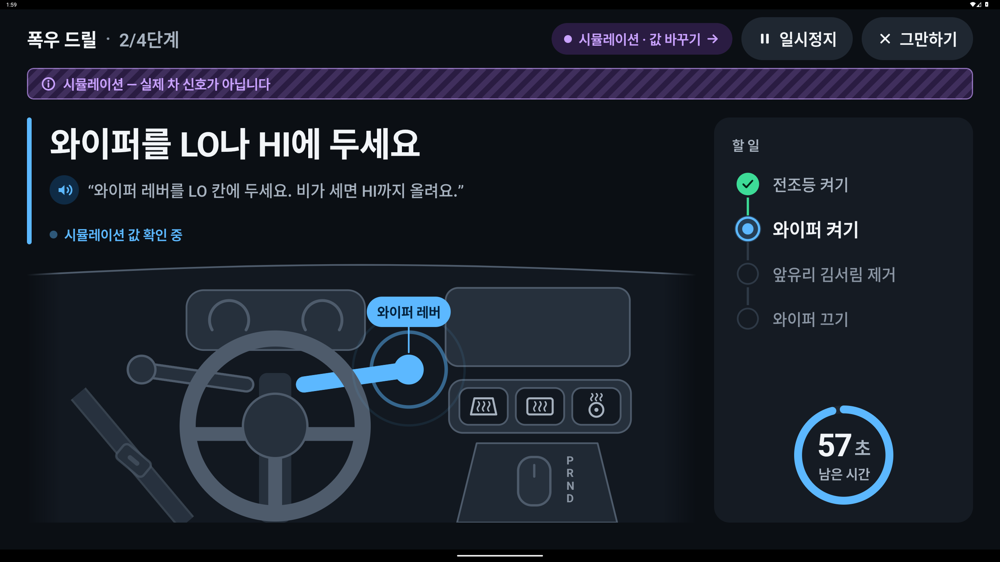

# 차 길들이기

차를 세워 두고 진짜 레버와 버튼을 움직이면, 차가 읽은 값(Pleos Vehicle SDK)으로 정답을 판정하는 차 기능 실습 앱입니다.

> 이 앱은 공모전 출품용 프로토타입입니다. 42dot·현대자동차그룹이 만들거나 보증한 앱이 아닙니다.



## APK

- 위치: [`apk/<팀명>_차길들이기_release.apk`](apk/) (release 서명본)
- 용량 초과 시: GitHub Releases 페이지 주소 (제출 직전에 채움)

## 실행 방법

1. Pleos Connect 에뮬레이터를 켜고 Virtual Console을 엽니다.
2. APK를 설치합니다.
   ```sh
   adb install -r "apk/<팀명>_차길들이기_release.apk"
   ```
3. 런처에서 **차 길들이기**를 엽니다. 기어를 **P**에 두면 홈의 드릴 카드가 열립니다.
4. **폭우 드릴**을 누르고, 화면의 지시대로 Virtual Console에서 전조등 → 와이퍼 → 앞유리 김서림 → 와이퍼 끄기를 조작합니다.
5. 오른쪽 위 **신호 출처 칩**(차 신호 / 시뮬레이션)을 누르면 판정 로그가 열립니다.

소스에서 빌드:
```sh
export JAVA_HOME="/Applications/Android Studio.app/Contents/jbr/Contents/Home"
./gradlew assembleDebug testDebugUnitTest      # 디버그 + 단위 테스트
./gradlew assembleRelease                      # keystore.properties 필요 (저장소에 없음)
```

## 테스트 환경 및 필요한 설정

| 항목 | 값 |
|---|---|
| 개발에 사용한 에뮬레이터 | Pleos Connect v2.1.0 (Android Automotive OS, API 34, Vehicle Service 2.3.22) |
| 화면 규격 | 2560×1440 가로, density 160 (2560×1440dp) |
| Vehicle SDK | `ai.pleos.playground:Vehicle:2.3.2` (빌드 때 Maven에서 받음. 저장소에 포함하지 않음) |
| minSdk / targetSdk | 29 / 34 |
| 권한 | 읽기 전용 `CAR_DRIVE`(기어), `CAR_WINDOWS`(와이퍼), `CAR_LIGHTS`(전조등), `CAR_CLIMATE`(김서림·열선), `READ_WINDSHIELD_WIPERS`. 설치 시 자동 부여. |

- **주차에서만 열립니다.** 기어가 P이면 드릴이 열리고, D·R이면 "주행 중에는 쉬어요" 화면으로 바뀌며 진행 중인 드릴은 멈춥니다. 다시 P에 두면 "이어서 할까요?"가 나옵니다. 차가 기어를 읽지 못하면 "P에 두셨나요?"로 한 번 확인합니다.
- **시뮬레이션 모드.** Vehicle Service가 없는 일반 에뮬레이터에서는 3초 안에 차 값이 오지 않으면 자동으로 시뮬레이션 모드로 바뀝니다. Pleos 에뮬레이터에서도 판정 로그 패널의 "신호 출처"에서 직접 켤 수 있습니다. 켜져 있으면 모든 화면 위에 "시뮬레이션 — 실제 차 신호가 아닙니다"가 보이고, 오른쪽 위 **시뮬레이션 · 값 바꾸기** 칩을 눌러 여는 패널에서 기어·전조등·와이퍼·김서림·열선 값을 직접 바꿀 수 있습니다. 와이퍼 값은 Virtual Console 카드와 같은 끔·AUTO·LO·HI만 둡니다.
- 앱은 차 값을 **읽기만** 합니다. SDK의 `set*` 함수를 호출하지 않고, 네트워크를 쓰지 않으며, 기록은 기기 안에만 남습니다([PRIVACY.md](PRIVACY.md)).
- 화면은 1707×960dp 캔버스로 설계했고, 화면 크기에 맞춰 비율 그대로 확대·축소합니다(Pleos 2560×1440dp에서 1.5배).
- 낮/밤 테마는 시스템 설정을 따릅니다. 시연용으로 판정 로그 패널의 "화면: 자동·낮·밤"에서 바꿀 수 있습니다.

## 프로토타입 범위

| 기능 | 판정 방식 |
|---|---|
| 폭우 드릴(60초): 전조등, 와이퍼 켜기(LO·HI), 앞유리 김서림, 와이퍼 끄기 | Vehicle SDK 값으로 판정. 값을 읽지 못하거나 8초 동안 값이 전혀 바뀌지 않으면 "켰어요" 운전자 확인(자가 확인 칸은 도면에 점등하지 않음) |
| 세차 대비 드릴: 와이퍼 OFF | Vehicle SDK |
| 성에 낀 아침 드릴: 앞·뒷유리 열선, 핸들 열선 (+ 와이퍼 OFF 주의) | Vehicle SDK |
| 출발 준비 드릴(벨트) | "준비 중" 카드만 표시 (SDK 2.3.2에 벨트 값 없음) |
| 안전 단계 (주행 중 정지 / P 확인) | 기어 값 + CarUxRestrictions (읽을 수 있을 때) |
| 시뮬레이션 모드 | Vehicle Service가 없으면 자동으로, 또는 판정 로그 패널의 "신호 출처"에서 직접 켤 때. 켜져 있으면 모든 화면 위에 항상 표시 |
| 음성 안내 | 기기 TTS (한국어 음성이 없으면 조용히 생략) |

드릴 내용은 `app/src/main/assets/quests/*.json` 데이터이고, 엔진 하나가 모든 드릴을 판정합니다.

## 문서

- 개발 계약: [docs/SPEC.md](docs/SPEC.md) · 화면 명세: [docs/design/SCREENS.md](docs/design/SCREENS.md)
- 자동차 도메인 검토: [docs/domain/DOMAIN_REVIEW.md](docs/domain/DOMAIN_REVIEW.md)
- 보안·법률 검토: [docs/compliance/REVIEW.md](docs/compliance/REVIEW.md) · 시연 대본: [docs/DEMO_SCRIPT.md](docs/DEMO_SCRIPT.md)
- 화면 캡처: [docs/screenshots/](docs/screenshots/)

## 라이선스

All rights reserved. 심사를 위한 열람·빌드·설치·실행은 허락합니다. [LICENSE](LICENSE), [NOTICE.md](NOTICE.md).
