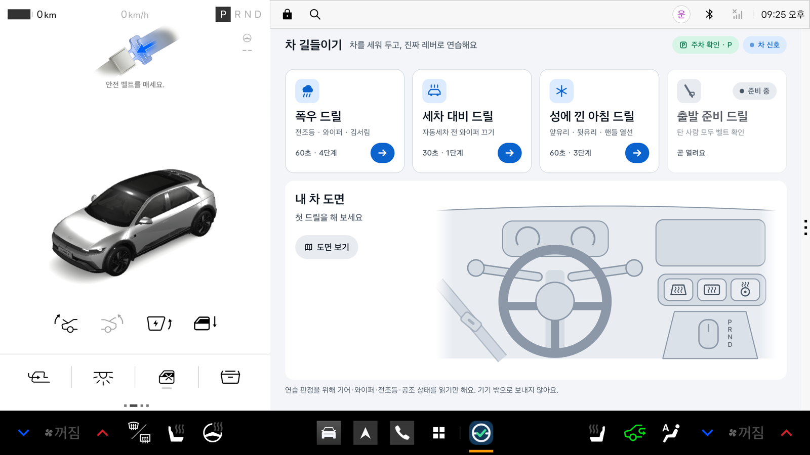
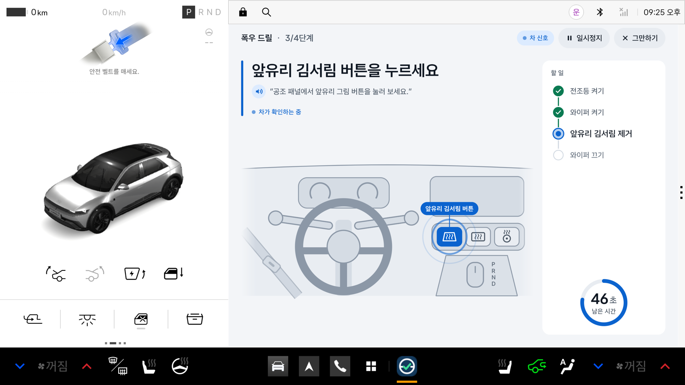
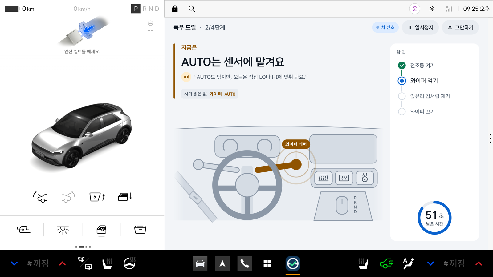
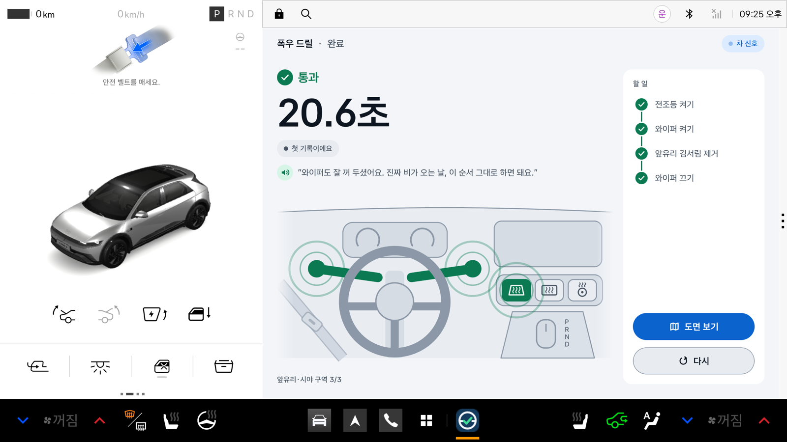

# 차 길들이기

차를 세워 두고 실제 레버와 버튼을 움직이면, 차가 읽은 값으로 정답을 판정하는 차 기능 실습 앱입니다. 차량 값은 Pleos Vehicle SDK로 읽습니다.

이 앱은 공모전 출품용 프로토타입이며, 42dot이나 현대자동차그룹이 만들거나 보증한 앱이 아닙니다.

## 스크린샷

아래 화면은 모두 Pleos Connect v2.1.0 에뮬레이터에서 release APK를 실행하고, Virtual Console로 실제 차량 값을 바꿔 가며 찍었습니다. 앱은 오른쪽 창에 뜹니다.

| 홈 (기어 P를 읽어 주차 확인) | 폭우 드릴 진행 |
|---|---|
|  |  |
| 와이퍼를 AUTO로 잘못 두었을 때 | 완료 |
|  |  |

기어를 D로 바꾸면 Pleos가 앱 화면을 가립니다([캡처](docs/screenshots/pleos-05-driving-blocked.png)). 밤 테마, 시간 초과, 내 차 도면, 시뮬레이터 패널 화면은 [docs/screenshots](docs/screenshots/) 폴더에 있으며, 이 화면들은 일반 Android Automotive 에뮬레이터에서 시뮬레이션 모드로 찍었습니다.

## 주요 기능

- 실습 드릴: 화면이 한 번에 한 가지씩 지시하면 운전자가 실제 레버와 버튼을 움직입니다. 앱은 Vehicle SDK로 바뀐 값을 읽고, 그 값이 1초 동안 유지되면 통과로 판정합니다.
- 드릴 네 가지: 폭우 드릴(전조등, 와이퍼, 앞유리 김서림, 와이퍼 끄기), 세차 대비 드릴, 성에 낀 아침 드릴, 출발 준비 드릴(준비 중). 드릴은 `app/src/main/assets/quests` 폴더의 JSON 데이터이고, 판정 엔진 하나가 모두 처리합니다.
- 잘못 조작했을 때 안내: 다른 값으로 바꾸면 무엇이 다른지 바로 알려 줍니다. 시간이 다 되면 못 찾은 조작부의 위치를 크게 보여 줍니다.
- 위치 그림과 내 차 도면: 운전석에서 본 그림에 지금 찾을 조작부가 깜빡이고, 해 본 조작부는 도면에 불이 켜집니다.
- 안전 단계: 기어가 P일 때만 드릴이 열립니다. 주행 중에는 앱 화면이 멈추고, 다시 P에 두면 이어서 할 수 있습니다.
- 판정 로그: 차가 읽은 값과 판정 이유를 시간순으로 보여 줍니다. 예시 `00:21.8 · Wiper 스위치 OFF → CONTINUOUS_LEVEL_1 · 1초 안정 · 통과`
- 시뮬레이션 모드: Vehicle Service가 없는 기기에서도 전체 흐름을 볼 수 있습니다. 이때는 화면에 시뮬레이션임을 항상 표시합니다.
- 그 밖에 음성 안내(기기 TTS), 낮과 밤 테마, 큰 글씨와 76dp 이상의 터치 영역을 갖췄습니다.

## 실행 방법

### 1. APK 설치

```sh
adb install -r "apk/컬러팡_홍보팀_차길들이기_release.apk"
```

기기가 여러 대 연결되어 있으면 `adb -s <기기 serial> install -r ...` 로 대상을 지정합니다. 설치 후 앱 목록에서 차 길들이기를 엽니다.

### 2. 소스에서 빌드

```sh
export JAVA_HOME="/Applications/Android Studio.app/Contents/jbr/Contents/Home"   # JDK 17 이상
./gradlew assembleDebug testDebugUnitTest   # 디버그 APK와 단위 테스트
./gradlew assembleRelease                   # release APK (서명 설정 필요)
```

- 결과물은 `app/build/outputs/apk/debug/app-debug.apk`, `app/build/outputs/apk/release/app-release.apk` 에 생깁니다.
- release 서명 정보는 저장소 루트의 `keystore.properties` 에서 읽습니다. 이 파일은 git에 올리지 않습니다. 직접 빌드할 때는 본인 키스토어로 아래 네 줄을 만들어 두세요. 파일이 없으면 서명되지 않은 release APK가 만들어집니다.

```properties
storeFile=/절대/경로/my-release.jks
keyAlias=...
storePassword=...
keyPassword=...
```

### 3. Pleos Connect 에뮬레이터와 Virtual Console에서 실행

1. Pleos Connect 에뮬레이터를 켜고 APK를 설치합니다.
2. Virtual Console의 Gear Selection 카드에서 기어를 P에 둡니다. 앱 오른쪽 위에 주차 확인 표시가 뜨고 드릴이 열립니다.
3. 폭우 드릴을 시작하고, 화면 지시에 따라 Virtual Console을 조작합니다.

| 드릴 단계 | Virtual Console 조작 | 앱이 읽는 값 |
|---|---|---|
| 전조등 켜기 | Exterior Lights Mode를 Low beam으로 | LowBeam 스위치 ON |
| 와이퍼 켜기 | Windshield Wiper Switch를 Low 또는 High로 | CONTINUOUS_LEVEL_1 또는 CONTINUOUS_LEVEL_3 |
| 앞유리 김서림 제거 | Defroster의 Front를 On으로 | 앞유리 디프로스터 ON |
| 와이퍼 끄기 | Windshield Wiper Switch를 Off로 | OFF |

4. 와이퍼를 Auto로 두면 잘못 조작했을 때의 안내를 볼 수 있습니다.
5. 기어를 D나 R로 바꾸면 Pleos가 앱 화면을 가리고 드릴이 멈춥니다. 다시 P에 두면 이어서 할 수 있습니다.
6. 오른쪽 위 신호 출처 표시(차 신호)를 누르면 판정 로그가 열립니다.

위 표의 값은 Pleos Connect v2.1.0 에뮬레이터에서 직접 확인했습니다. 참고로 Exterior Lights Mode의 Auto, Tail lamp, Off는 모두 LowBeam 스위치 OFF로 읽힙니다. 차가 어떤 값을 읽지 못하거나 8초 동안 값이 바뀌지 않으면, 운전자가 직접 했다고 누르는 확인 버튼이 나옵니다. 와이퍼 단계는 레버 값으로만 통과합니다.

### 4. 시뮬레이션 모드

- Vehicle Service가 없는 일반 Android Automotive 에뮬레이터에서는 3초 안에 차 값이 오지 않으면 자동으로 시뮬레이션 모드가 됩니다.
- Pleos 에뮬레이터에서도 판정 로그 패널 아래 시연 설정의 신호 출처에서 시뮬레이션을 고를 수 있습니다.
- 오른쪽 위 시뮬레이션 표시를 누르면 시뮬레이터 패널이 열립니다. 기어, 전조등, 와이퍼(끔, AUTO, LO, HI), 앞유리 김서림, 뒷유리 열선, 핸들 열선 값을 눌러 바꿀 수 있습니다.
- 폭우 드릴 예시: 드릴 시작, 전조등 켬, 와이퍼 LO, 앞유리 김서림 켬, 와이퍼 끔 순서로 누르면 완료 화면이 나옵니다.

## 테스트 환경 및 필요한 설정

| 항목 | 내용 |
|---|---|
| 개발 PC | macOS, Android Studio 내장 JBR (JDK 17 이상) |
| 빌드 도구 | Gradle Wrapper 8.14.3, Android Gradle Plugin 8.9.1, Kotlin 2.1.20, compileSdk 35 |
| minSdk / targetSdk | 29 / 34, Android Automotive OS 전용 |
| Vehicle SDK | `ai.pleos.playground:Vehicle:2.3.2`. 빌드할 때 Pleos Playground Maven 저장소(`https://nexus-playground.pleos.ai/repository/maven-releases/`)에서 받으며, SDK 파일은 저장소에 넣지 않았습니다. |
| 권한 | 차량 값을 읽는 권한만 씁니다. 기어(`CAR_DRIVE`), 와이퍼(`CAR_WINDOWS`, `READ_WINDSHIELD_WIPERS`), 전조등(`CAR_LIGHTS`), 김서림과 열선(`CAR_CLIMATE`). 차를 제어하는 `CONTROL_*` 권한과 인터넷 권한은 없습니다. |
| 단위 테스트 | `./gradlew testDebugUnitTest` 로 판정 엔진, 안전 단계, 신호 전환, 퀘스트 로딩 46개 테스트 |

- 화면은 가로 전용입니다. 1707x960dp 기준으로 설계했고, 실제 화면 크기에 맞춰 같은 비율로 키우거나 줄입니다.
- 낮과 밤 테마는 시스템 설정을 따르며, 판정 로그 패널의 시연 설정에서 바꿀 수도 있습니다.
- 음성 안내는 기기에 한국어 TTS가 있을 때만 나옵니다.

## 개발에 사용한 Pleos Connect 에뮬레이터 버전과 화면 규격

| 항목 | 내용 |
|---|---|
| 에뮬레이터 | Pleos Connect v2.1.0 (Android Automotive OS, Android 14, API 34, arm64), Vehicle Service 2.3.22 |
| 화면 규격 | 2560x1440 가로, density 160 |
| 앱 표시 영역 | Pleos 홈 화면 오른쪽 창, 약 1707x1210 |
| 사용한 Virtual Console 카드 | Gear Selection, Windshield Wiper Switch, Exterior Lights Mode, Defroster, Steering Wheel Heat |

같은 해상도의 일반 Android Automotive 에뮬레이터에서도 시뮬레이션 모드로 전체 흐름을 확인했습니다.

## APK 파일 위치

- 저장소 안: [apk/컬러팡_홍보팀_차길들이기_release.apk](apk/컬러팡_홍보팀_차길들이기_release.apk) (release 서명, 약 22MB)
- 백업: [GitHub Release v0.1.0](../../releases/tag/v0.1.0)

## 프로젝트 구조

```
app/src/main/
├─ java/com/chagil/app/
│  ├─ vehicle/   Vehicle SDK 읽기, 시뮬레이터, 자동 전환
│  ├─ safety/    안전 단계 판단 (L0, L1, L2)
│  ├─ engine/    퀘스트 JSON 로딩과 드릴 판정
│  ├─ data/      기록 저장 (기기 안에만)
│  ├─ voice/     음성 안내
│  ├─ core/      의존성 묶음
│  └─ ui/        화면, 공통 부품, 테마
├─ assets/quests/  드릴 데이터
app/src/test/      단위 테스트
apk/               제출용 release APK
docs/              개발 계약, 화면 명세, 도메인과 보안 검토, 시연 대본, 스크린샷
```

## 안전 설계

| 단계 | 조건 | 앱 동작 |
|---|---|---|
| L0 주행 중 | 기어 D, R, 1~9 또는 시스템의 주행 제한(CarUxRestrictions) | 드릴을 멈추고 음성을 끕니다. Pleos는 주행 중 앱 화면을 가립니다. |
| L1 정차, 기어 확인 전 | 기어가 N이거나 읽을 수 없을 때 | 운전자에게 P에 두었는지 한 번 확인합니다. N이면 P로 옮기라고 안내합니다. |
| L2 주차 | 기어 P | 모든 드릴이 열립니다. |

- 앱은 차를 대신 조작하지 않습니다. Vehicle SDK의 읽기 함수(`get*`, `register*`)만 쓰고 `set*` 함수는 호출하지 않습니다.
- 네트워크를 쓰지 않으며, 기록은 기기 안에만 남습니다.

## 시뮬레이션 표시 원칙

- 시뮬레이션 값으로 판정하는 동안에는 모든 화면 위에 "시뮬레이션 중이에요. 실제 차 신호가 아니에요" 띠가 보입니다.
- 오른쪽 위 신호 출처 표시가 실제 값일 때는 차 신호, 시뮬레이션일 때는 시뮬레이션으로 바뀝니다.
- 판정 로그의 각 줄 앞에 `SIM` 표시가 붙습니다.
- 실제 차 신호를 받을 때는 시뮬레이터 패널을 숨깁니다.
- 시연 영상의 시뮬레이션 장면은 화면 띠와 자막으로 함께 밝힙니다. 자세한 내용은 [docs/DEMO_SCRIPT.md](docs/DEMO_SCRIPT.md)에 있습니다.

## 문서

- 개발 계약: [docs/SPEC.md](docs/SPEC.md)
- 화면 명세와 디자인 시스템: [docs/design/SCREENS.md](docs/design/SCREENS.md), [docs/design/DESIGN.md](docs/design/DESIGN.md)
- 자동차 도메인 검토: [docs/domain/DOMAIN_REVIEW.md](docs/domain/DOMAIN_REVIEW.md)
- 보안과 법률 검토: [docs/compliance/REVIEW.md](docs/compliance/REVIEW.md), 제출 체크리스트: [docs/compliance/SUBMISSION_CHECKLIST.md](docs/compliance/SUBMISSION_CHECKLIST.md)

## 라이선스와 개인정보

- [LICENSE](LICENSE): 모든 권리를 보유합니다. 심사를 위한 열람, 빌드, 설치, 실행은 허락합니다.
- [NOTICE.md](NOTICE.md): 제3자 구성 요소와 라이선스. Pleos Vehicle SDK는 42dot SDK 라이선스를 따릅니다.
- [PRIVACY.md](PRIVACY.md): 앱이 읽는 값과 저장하는 기록
