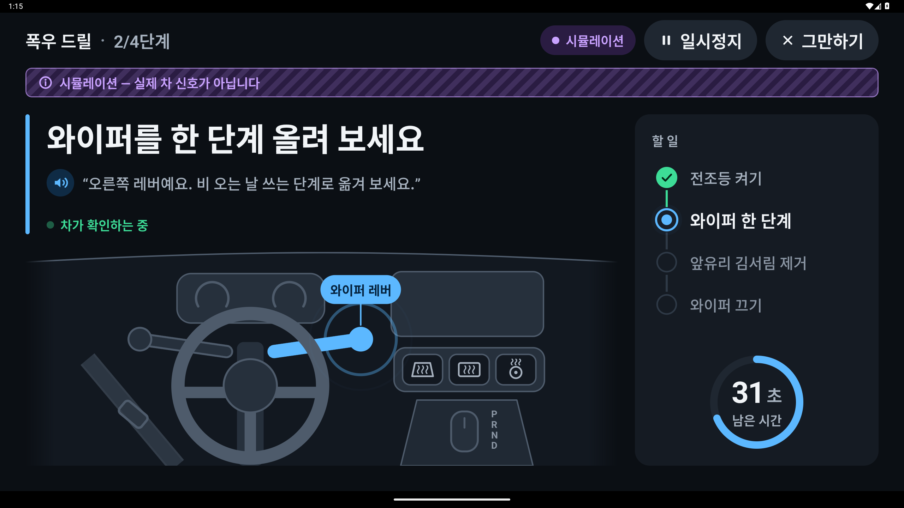
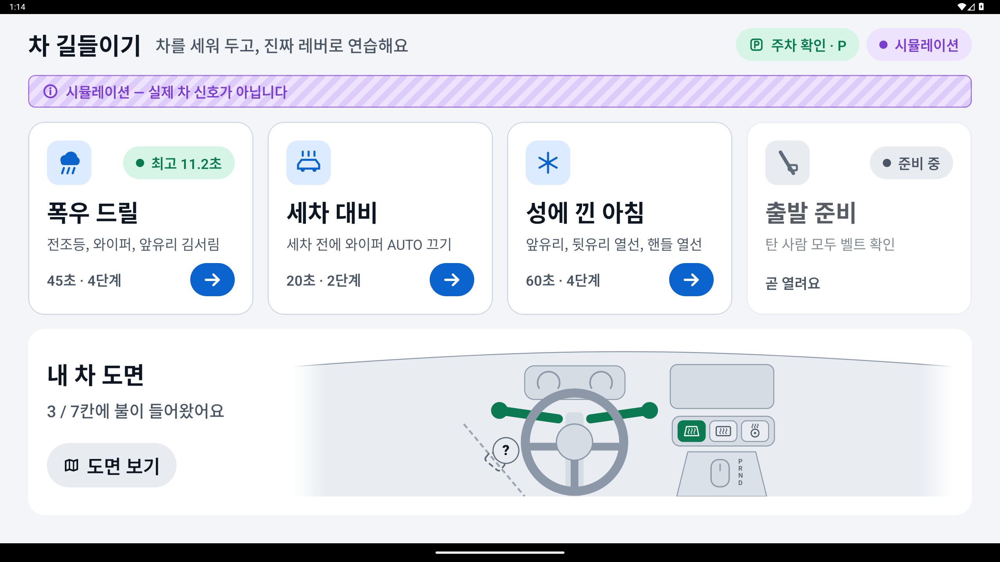
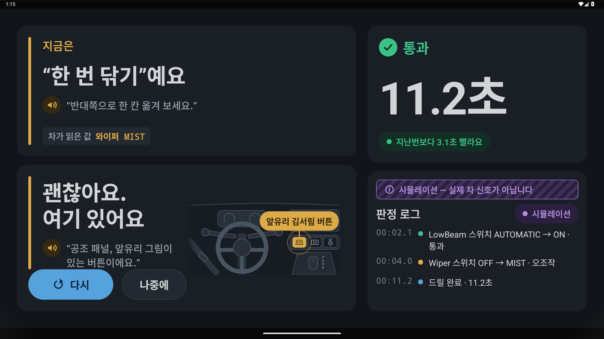

# 차 길들이기 디자인 시스템

코드: `app/src/main/java/com/chagil/app/ui/theme/**`, `ui/components/**`.
화면 배치 명세: [SCREENS.md](SCREENS.md). 갤러리 캡처: `img/`.

## 1. 원칙 (무엇을 가져왔고 왜 가져왔나)

| 원칙 | 출처 | 이 앱에서 |
|---|---|---|
| 한눈에 읽기 (glanceability) | Android for Cars 디자인 기초, Apple CarPlay HIG | 화면마다 지금 할 일 한 줄(60sp)만 크게 쓰고 나머지는 보조 정보로 둔다. 2초 안에 읽혀야 한다. |
| 눈은 조작부에, 귀는 앱에 | 기획서, CarPlay 음성 우선 원칙 | 지시 문장은 TTS 문구와 같은 뜻으로 짧게 쓴다. 소리가 주 채널이고 화면은 확인용이다. |
| 터치 타깃 76dp 이상, 간격 24dp 이상 | Android for Cars sizing | 큰 버튼 88dp, 상단 버튼과 시뮬레이터 버튼 76dp, 버튼 사이 24dp. |
| 주 텍스트 32dp, 보조 24dp 이상 | Android for Cars visual principles | 지시 60sp, 제목 40sp, 주 텍스트 32sp, 본문 최소 24sp. 24sp보다 작은 글자는 없다. |
| 밤이 기본, 검정 대신 짙은 남색 | Polestar AAOS(검정 배경에 흰 글씨), 밤 지도가 낮에 안 보인다는 Rivian 리뷰의 교훈 | 밤 배경은 순검정 대신 `#0B0F14`를 써서 번짐을 줄인다. 낮 테마를 따로 두어 시스템 낮/밤 모드를 따른다. |
| 각진 차 UI 대신 크고 부드러운 모서리 | Rivian과 Tesla의 최근 UI, 모바일 트렌드 | 카드 28dp, 프롬프트 36dp, 버튼은 알약형. 연습과 놀이라는 앱 성격에 맞게 친근하게 만든다. |
| 진행 표시는 게임처럼, 하지만 절제해서 | Duolingo 학습 경로, 스트릭 | 단계 목록의 연결선이 초록으로 채워지고 내 차 도면에 불이 들어온다. 점수, 랭킹, 뽑기, 하트 감점은 없다. 기획서에서 보상은 배지와 도면 표시뿐이다. |
| 실패라고 하지 않는다 | 기획서 | 시간 초과와 오조작은 빨강이 아닌 호박색(attention)으로 보여 주고 "괜찮아요. 여기 있어요"라고 말한다. 빨강은 L0 주행 상태에만 쓴다. |
| 시뮬레이션은 숨기지 않는다 | 심사 신뢰, 정직 | 보라색 줄무늬 띠에 "시뮬레이션 중이에요. 실제 차 신호가 아니에요"를 쓴다. 실차 신호와는 색부터 다르다. |

## 2. 색 토큰 (`ChagilColors`, `NightColors` / `DayColors`)

색마다 뜻이 정해져 있다. primary는 지금 할 것, success는 차가 확인한 것, attention은 다시 볼 것(오조작과 시간 초과, 탓하지 않음), sim은 실제 신호가 아닌 것, rest는 L0 주행 중(유일한 빨강 계열)이다.

| 토큰 | 밤 | 낮 | 쓰임 |
|---|---|---|---|
| background | `#0B0F14` | `#F3F5F8` | 화면 바탕 |
| surface | `#151B23` | `#FFFFFF` | 카드, 단계 패널 |
| surfaceRaised | `#1F2731` | `#E8ECF1` | 보조 버튼, 칩, 읽은 값 상자 |
| outline | `#2E3946` | `#D3DAE2` | 카드 테두리, 대기 단계 원 |
| text | `#F2F5F8` | `#0E1621` | 본문, 지시 |
| textSecondary | `#A7B2BF` | `#4A5664` | 음성 문구, 설명 |
| textTertiary | `#8A95A3` | `#5F6B79` | 남은 단계, 시간 표기 |
| primary / onPrimary | `#5CB8FF` / `#04223D` | `#0B63CE` / `#FFFFFF` | 주 버튼, 현재 단계, 위치 그림 강조 |
| success / onSuccess | `#3DDC97` / `#032617` | `#0B7A52` / `#FFFFFF` | 통과 ✓, 도면 점등, 차가 확인하는 중 |
| attention / onAttention | `#FFC24D` / `#2E1F00` | `#8F5300` / `#FFFFFF` | 오조작 안내, 시간 초과, 남은 10초, L1 |
| sim / onSim | `#C9A2FF` / `#1E0B3A` | `#7A3FD1` / `#FFFFFF` | 시뮬레이션 띠와 칩, 시뮬레이터 선택 |
| rest | `#FF8A7A` | `#B3261E` | L0 "주행 중 · 쉬어요"에만 |
| cockpitLine / Fill / Part | `#4E5B6B` / `#121820` / `#26303C` | `#8C98A7` / `#E9EDF2` / `#D5DCE4` | 운전석 그림의 기본(강조하지 않은) 부품 |

### 대비 (WCAG 2.1, 직접 계산)

| 전경 | 밤: bg / surface / raised | 낮: bg / surface / raised |
|---|---|---|
| text | 17.6 / 15.8 / 13.8 | 16.6 / 18.2 / 15.3 |
| textSecondary | 8.9 / 8.0 / 7.0 | 6.9 / 7.5 / 6.3 |
| textTertiary | 6.3 / 5.7 / 5.0 | 5.0 / 5.4 / 4.6 |
| primary | 8.9 / 8.0 / 7.0 | 5.2 / 5.7 / 4.8 |
| success | 10.9 / 9.8 / 8.5 | 4.9 / 5.4 / 4.5 |
| attention | 12.0 / 10.8 / 9.4 | 5.6 / 6.2 / 5.2 |
| sim | 9.2 / 8.3 / 7.2 | 5.6 / 6.1 / 5.1 |
| onPrimary on primary | 7.5 | 5.7 |
| onSim on sim | 8.7 | 6.1 |
| 칩: 색 on 같은 계열 container (primary / success / attention / sim / rest) | 6.7 / 8.3 / 9.2 / 7.5 / 6.8 | 4.7 / 4.6 / 5.4 / 4.9 / 5.4 |

모든 텍스트 조합이 AA(4.5:1) 이상이다. 글자가 모두 24sp 이상이라 실제로 적용되는 기준은 AA Large(3:1)이고, 여유가 크다.

## 3. 글꼴 (`ChagilTypography`)

시스템 글꼴만 쓴다(AAOS에서는 Noto Sans CJK). 글꼴 파일은 넣지 않는다.

| 토큰 | 크기/줄높이 | 굵기 | 쓰임 |
|---|---|---|---|
| hero | 128/136sp, tnum | Bold | 완료 시간 (예: 11.2초) |
| instruction | 60/74sp | Bold | 드릴 지시 한 줄, 프롬프트 질문 |
| number | 56/60sp, tnum | Bold | 남은 시간 숫자 |
| headline | 40/52sp | Bold | 화면과 카드 제목 |
| title | 32/42sp | SemiBold | 현재 단계, 상단 바 제목, eyebrow(지금은) |
| button | 30/36sp | Bold | 큰 버튼 |
| bodyLarge | 28/40sp | Medium | 음성 문구, 설명 |
| body | 24/34sp | Regular | 최소 본문 |
| label | 24/30sp | SemiBold | 칩, 작은 라벨 |
| mono | 24/34sp Monospace | Medium | 판정 로그 시간, SDK 원값(`MIST`) |

한국어 줄바꿈: 모든 스타일에 `localeList = ko-KR`과 `LineBreak.WordBreak.Phrase`를 넣었다. 어절 단위로 줄을 바꾸며 keep-all과 같은 효과를 낸다. 이 설정이 없으면 en-US 기기에서 여/기처럼 글자 사이가 끊긴다. 미리보기 에뮬레이터에서 확인하고 고쳤다. 화면 개발자는 `Text`에 반드시 `ChagilTheme.type.*` 스타일을 쓰고, `fontSize`만 따로 바꾸지 않는다. `copy()`로 크기만 바꾸면 locale은 그대로 남는다.

## 4. 간격, 모양, 움직임

- `ChagilSpacing`: 8dp 격자. xxs 4, xs 8, s 12, m 16, l 24, xl 32, xxl 48, xxxl 64. pageGutter 48(폭 1400dp 미만이면 32), targetGap 24, touchMin 76, buttonHeight 88, chipHeight 56, topBarHeight 104, stepRowHeight 80.
- `ChagilShapes`: small 12, medium 20, large 28(카드), xl 36(프롬프트), pill(버튼과 칩).
- `ChagilMotion`: fast 150, medium 250, slow 400, pulse 1400ms, celebrate 700ms. 깜빡임은 초당 3회 미만으로 한다(WCAG 2.3.1). 위치 그림의 맥박 고리는 1.4초 주기로 두 겹이다. 남은 시간은 900ms, 색 바뀜은 250ms에 걸쳐 부드럽게 바뀐다.
- 접근성: 단계 행, 칩, 카드는 `mergeDescendants`로 묶어 한 문장으로 읽힌다(예: 와이퍼 한 단계, 지금 할 단계). 지시 블록은 `liveRegion=Polite`.

## 5. 컴포넌트 목록 (`ui/components`)

| 컴포넌트 | 주요 파라미터 | 비고 |
|---|---|---|
| `InstructionPanel` | headline, eyebrow?, voice?, readValue?, checking, tone(NORMAL/HINT/CALM/SUCCESS) | 왼쪽 8dp 색 막대, 60sp 지시, 스피커 아이콘과 음성 문구, 차가 확인하는 중 또는 차가 읽은 값 |
| `StepList` / `StepRow` | `StepItem(label, StepState)` DONE ✓ / ACTIVE ● / PENDING ○ / ATTENTION ! | 80dp 행, 완료 구간 연결선은 초록 |
| `CountdownRing` / `CountdownBar` | remainingSec, totalSec, paused | 10초 이하에서 호박색(빨강 아님), 멈춤 표시 |
| `SafetyChip` | `SafetyChipLevel` L0/L1/L2, confirmedByDriver | 문구: "주행 중 · 쉬어요" / "정지 · P 확인 필요" / "정지 · P 확인함" / "주차 확인 · P" |
| `SourceChip` | simulation | "실차 신호"(파랑, 깜빡이는 점) / "시뮬레이션"(보라) |
| `StatusChip` | text, color, container, icon? | 칩 공통 |
| `PrimaryButton` / `SecondaryButton` | text, onClick, icon?, enabled | 88dp, 알약형. 화면당 큰 버튼은 2개까지 |
| `TopBarButton` | text, onClick, icon? | 76dp. 상단의 일시정지, 그만하기, 닫기 버튼 |
| `DrillCard` | title, subtitle, meta, state(OPEN/COMING_SOON/LOCKED_BY_SAFETY), glyph, label?, best?, onClick? | 카드 전체가 터치 영역. label은 현대차 안내 같은 작은 알약 |
| `DrillGlyphView` | RAIN / CAR_WASH / FROST / BELT | 카드 그림 |
| `ControlPoint` | enum, `fromKey(String)` | 이름은 퀘스트 JSON의 `control` 값과 같다. `label`, `where`는 한국어 |
| `ControlLocator` | point, tone(NORMAL/ATTENTION/SUCCESS), showLabel, animate | 운전석 시점 Canvas 그림. 대상 부품 색, 맥박 고리, 이름 말풍선 |
| `CockpitMap` | Map<ControlPoint, ZoneState(LIT/UNLIT/QUIZ/JUST_LIT)>, showLabels | 같은 그림에 칸별 점등. QUIZ는 점선과 ? 표시 |
| `SimBanner` | text = `SIM_BANNER_TEXT` | 보라 줄무늬 띠 |
| `SimSwitchRow` | label, options, selected, onSelect, display | 시뮬레이터 조작 패널 한 줄(76dp 선택지) |
| `LogPanel` / `LogRow` | `LogLine(time, text, LogKind)` PASS/HINT/INFO/DONE, simulation | 시뮬레이션이면 위에 SimBanner 고정 |
| `PromptCard` | icon, title, body, primary/secondary 텍스트와 콜백 | 안전 확인, L0 휴식, 일시정지에 함께 쓴다 |
| `PauseCard` | progressText, onResume, onQuit | "이어서 할까요?" |
| `ResultHero` | timeText, deltaText, improved | 통과 표시, 128sp 시간, 비교 알약 |
| `DrillTopBar` | title, progress?, actions | "폭우 드릴 · 2/4단계"와 오른쪽 칩, 버튼 |
| `ChagilIconView` | `ChagilIcon` 11종 | 아이콘 글꼴이나 확장 아이콘에 의존하지 않는다 |
| `ComponentGallery` | page(0 드릴/1 홈/2 상태), night | 디자인 검토용. 제품 화면이 아니다 |

컴포넌트는 String, Boolean, enum, 람다만 받는다. `engine`, `vehicle`, `safety` 패키지에 의존하지 않는다. `SafetyLevel`을 `SafetyChipLevel`로, `StepStatus`를 `StepState`로 바꾸는 일은 화면 계층에서 한다.

## 6. 운전석 그림 (ControlLocator, CockpitMap)

- 가상 캔버스는 1000×600이다. 위쪽 140은 앞유리라 잘라 내서 실제 비율은 1000×460, 약 2.17:1이다. 좌핸들이고 브랜드 표시는 없다.
- 부품 위치: 라이트 레버(핸들 왼쪽), 와이퍼 레버(핸들 오른쪽), 공조 패널 버튼 3개(앞유리 김서림, 뒷유리 열선, 핸들 열선), 가운데 기어 손잡이와 P R N D, 왼쪽 아래 안전벨트.
- 레버를 위로 올리는지 아래로 내리는지는 차종마다 달라서 화살표를 그리지 않는다. 방향은 음성 문구와 오조작 안내가 맡는다.
- 핸들 열선 버튼이 강조되면 핸들 테두리도 같은 색으로 은은하게 칠한다.
- 좌우 끝 5%는 투명하게 사라지게 해서 어떤 레이아웃에 붙여도 이음매가 보이지 않는다.

## 7. 앱 아이콘

`res/drawable/ic_launcher_background.xml`과 `ic_launcher_foreground.xml`, `res/mipmap-anydpi-v26/ic_launcher(_round).xml`(monochrome 포함). 짙은 남색 바탕에 흰 핸들 테두리를 두고, 가운데 초록 체크로 차가 확인한다는 뜻을 담았다. 66dp 안전 영역 안에 들어간다. 매니페스트 연결은 `feat/screens`가 한다(`android:icon="@mipmap/ic_launcher"`, `android:roundIcon="@mipmap/ic_launcher_round"`).

## 8. 참고 자료

- Android for Cars, Visual principles: https://developers.google.com/cars/design/design-foundations/visual-principles
- Android for Cars, Sizing (AAOS 76dp touch target): https://developers.google.com/cars/design/automotive-os/design-system/sizing
- Android Auto, Sizing: https://developers.google.com/cars/design/android-auto/design-system/sizing
- Driving UX design principles (partner): https://docs.partner.android.com/drivingux/foundations/design-principles
- Apple HIG, CarPlay: https://developer.apple.com/design/human-interface-guidelines/carplay
- Polestar AAOS 인포테인먼트 리뷰(밤 화면, 흰 글씨): https://thedrive.com/car-reviews/polestar-2-android-automotive-os-infotainment-review-google-specs-system-tech-evs-electric-cars
- Polestar 맞춤 Google Maps(차 UI와 같은 모양과 강조색): https://www.androidauthority.com/google-maps-custom-design-elements-polestar-3564135
- Rivian 2025 UI 업데이트: https://www.thedrive.com/news/rivians-new-cel-shaded-infotainment-update-is-cool-and-mandatory
- WCAG 2.1 대비(1.4.3)와 번쩍임(2.3.1): https://www.w3.org/TR/WCAG21/
- Duolingo 학습 경로(진행 시각화 참고): https://blog.duolingo.com/new-duolingo-home-screen-design/
